# ボイラ圧力設定管理 操作マニュアル

- 版: v1.1（2026/11/15。履歴のページ送り、PC・タブレットでの表示を追記）
- 対象: ボイラの圧力設定を変える人（設定者）と管理者
- 画面の画像は、架空のデータで撮ったものです（`node tools/capture_manual.js` で撮り直せます）

---

## 1. はじめに

### 1.1 アプリを開く
管理者から知らされた URL を、スマホのブラウザで開きます。PC やタブレットのブラウザでも使えます（§3.6）。

### 1.2 ホーム画面に追加する（おすすめ）
次からワンタッチで開けるように、ホーム画面に追加しておきます。
- **iPhone（Safari）**: 画面下の共有ボタン（□に↑）→「ホーム画面に追加」→「追加」
- **Android（Chrome）**: 右上の「︙」→「ホーム画面に追加」→「追加」

### 1.3 設定者を選ぶ（最初の1回だけ）
初めて開くと「設定者」が出ます（「設定者を選択してください」）。自分の記入称を押してください。
次からは選んだ名前で開きます。ほかの人のスマホを借りたときは、右上の名前のボタンから選び直してください。

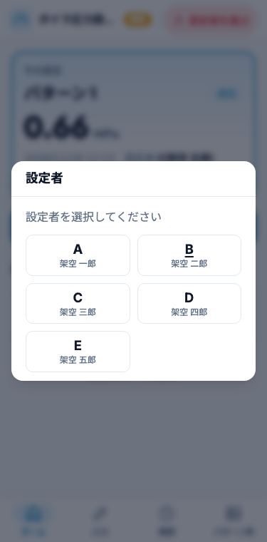

---

## 2. 設定を変えたときの記録

### 2.1 ホームから入力へ
ホームの「設定を変更して記録する」を押すか、画面下の「入力」を押します。

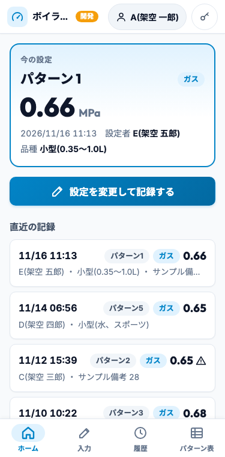

### 2.2 入力する
1. **設定パターン**: 設定したパターンの番号を押します。基準の圧力が自動で入ります。
2. **メインボイラ**: 「ガス」か「重油」を押します。
3. **設定圧力**: 基準と違う圧力にしたときは、「−」「＋」で 0.01 ずつ変えるか、数字を入れ直します。
4. **日付・時刻**: 開いたときの時刻が入っています。少し前に変えたときは直してください（「今の時刻にする」で戻せます）。
5. **生産品種**・**備考**: 分かれば入れます（入れなくても登録できます）。
6. 画面下の「登録する」を押します。

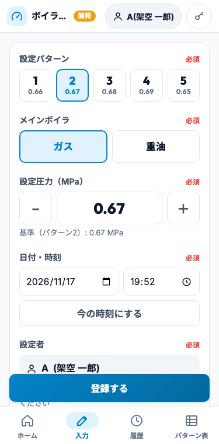

基準と違う圧力のときは、黄色の注意が出ます。そのままで正しければ、登録できます。

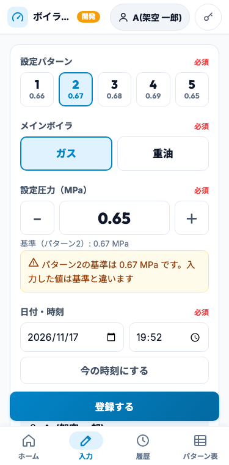

### 2.3 確認して登録する
内容を確かめて「登録する」を押します。「記録しました」と出て、ホームに戻ります。
ホームの「今の設定」が、いま登録した内容に変わっていれば完了です。

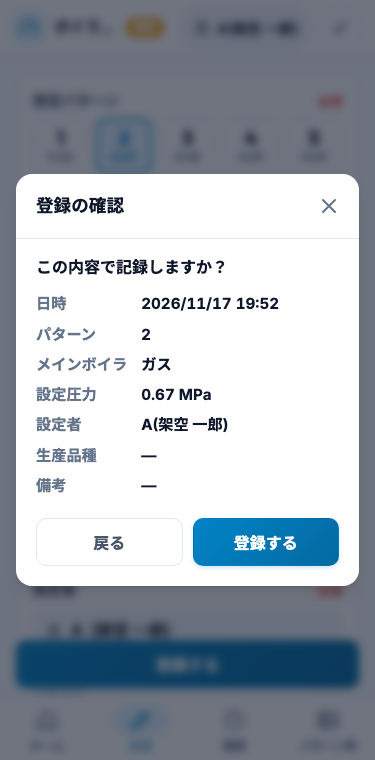

---

## 3. 今の設定と履歴を見る

### 3.1 今の設定
ホームのいちばん上に、最新の設定（パターン・圧力・燃料・日時・設定者）が出ます。設定者は「記入称(氏名)」の形で出ます。

### 3.2 履歴
画面下の「履歴」で、これまでの記録を新しい順に見られます。1ページに20件ずつ出ます（件数は管理者が「設定」シートの `HISTORY_PAGE_SIZE` で変えられます）。
- 一覧の下の「次へ ›」「‹ 前へ」でページを移ります。真ん中の「1 / 8 ページ」を押すと、好きなページを選べます。
- 一覧の上に「21〜40件目 ／ 全 154 件」のように、今見ている範囲が出ます。
- 絞り込みを変えると、1ページ目に戻ります。
⚠ の印は、基準と違う圧力の記録です。

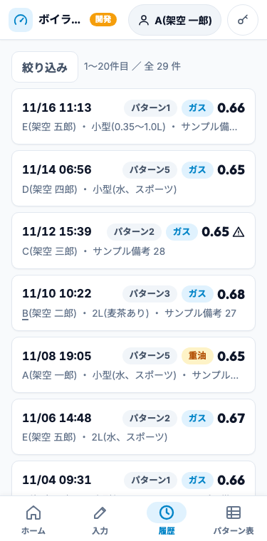

### 3.3 絞り込み
「絞り込み」を押すと、期間・パターン・メインボイラ・設定者・生産品種で絞れます。
「この条件で表示」で絞り込み、「条件をクリア」で元に戻します。

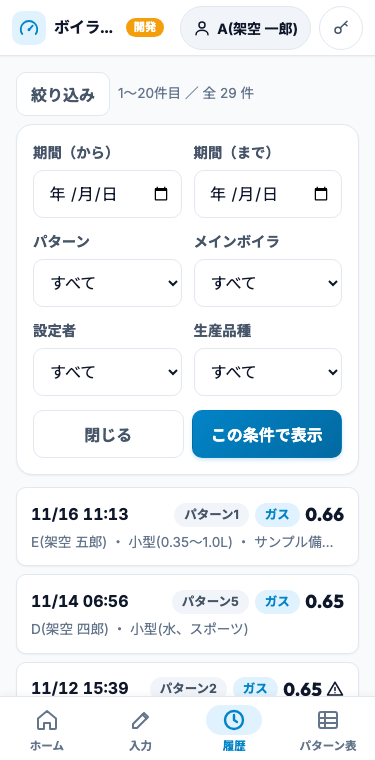

### 3.4 記録の詳細
一覧の記録を押すと、詳しい内容が下から出ます。

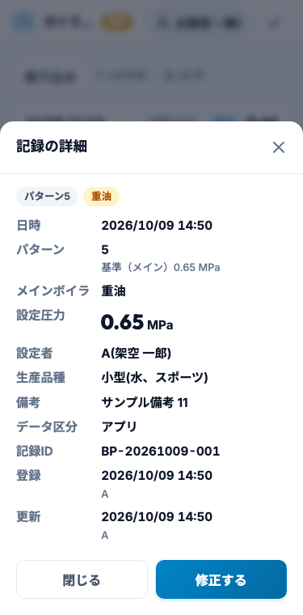

### 3.5 パターン表
画面下の「パターン表」で、パターンごとの基準の圧力と主な品種を見られます。今の設定のパターンに印が付きます。

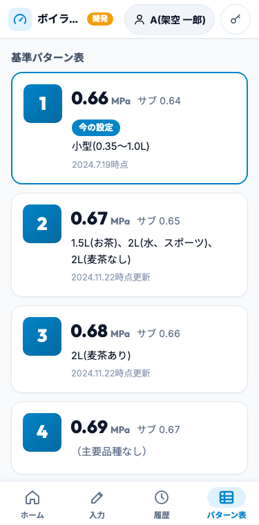

### 3.6 PC・タブレットで見る
同じ URL を PC やタブレットのブラウザで開くと、画面の広さに合わせた表示になります。
- **タブレット**（幅768px 以上）: ホームは「今の設定」と「直近の記録」が左右に並び、履歴は2列で出ます。ページ送りは番号のボタンになります。
- **PC**（幅1024px 以上）: 画面の切り替え（ホーム・入力・履歴・パターン表）が上に並びます。履歴は表の形で出て、絞り込みの欄はいつも開いています。行を押すと詳細が画面の中央に出ます。入力は左右2列になります。

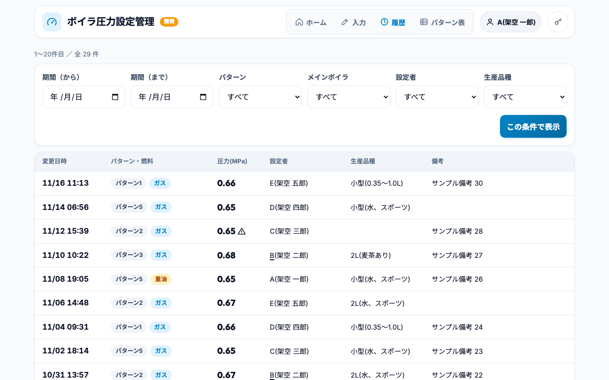

---

## 4. 記録を直す

- 自分がアプリで登録した記録は、あとから直せます（期限はありません）。
- 直し方: 履歴（またはホームの直近の記録）で記録を押し →「修正する」→ 直して「保存する」。
- ほかの人の記録や、Excel から移した記録は直せません。直したいときは管理者に頼んでください。
- 設定者の名前は変えられません（間違えたときは管理者に頼んでください）。

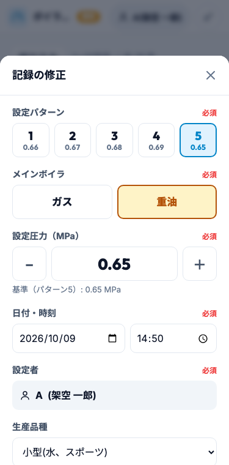

---

## 5. 管理者の操作

### 5.1 管理者モードに入る
右上の鍵のボタンを押すと「管理者認証」が出ます。管理者パスワードを入れて「認証する」を押します。認証すると、ヘッダに「管理者 30分」と出ます（スマホは「30分」だけ）。
- 30分たつと、自動で終わります（もう一度入れば続けられます）。
- 5回続けて間違えると、15分間は入れません。
- 終わるときは、ヘッダの「管理者 ○分」を押して「終了する」。

- パスワードは管理者が知っています。変えるときは、アプリの持ち主に頼みます。

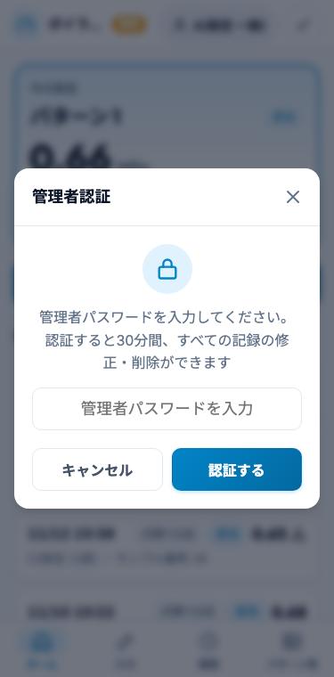

### 5.2 記録を直す・削除する・元に戻す
管理者モードでは、どの記録でも「修正する」「削除する」が出ます（設定者の名前も直せます）。
削除した記録は、履歴の「削除済みも表示」を押すと出てきます。押して「元に戻す」で戻せます。

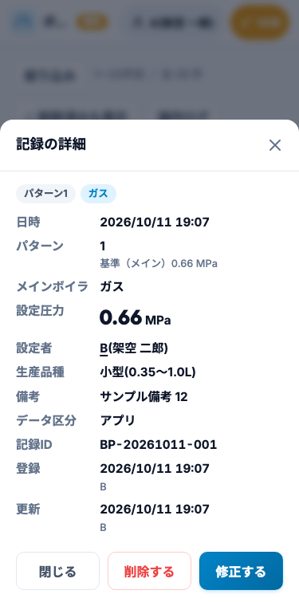

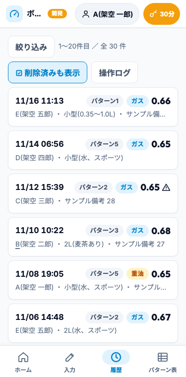

### 5.3 操作ログ
履歴の「操作ログ」で、だれが・いつ・何をしたか（登録・修正・削除・管理者認証など）を新しい順に見られます。

### 5.4 マスタの手入れ（スプレッドシート）
パターン・設定者・生産品種は、スプレッドシートのマスタで直します（docs/05 §4）。
- 退職した人は「有効」を FALSE にします（行は消しません）。
- パターンの番号・入力者ID・品種名は書き換えず、新しい行を足します。

---

## 6. スプレッドシートで見る

スプレッドシート「ボイラ圧力設定DB」の「圧力設定変更履歴」シートでも、記録を見られます。
- A〜I 列が記録の内容です。J 列より右（記録ID など）は、左上の「＋」で開けます。
- 削除した記録は灰色の取り消し線、基準と違う圧力は黄色で表示されます。
- 並べ替えや絞り込みは、「データ → フィルタを作成」で行ってください。
- **シートを直接書き換えないでください**（警告が出ます）。直すときはアプリから行います。

---

## 7. 困ったとき

| 表示 | どうする |
|---|---|
| 通信できませんでした | 電波のよい場所で、もう一度「登録する」を押してください。入力した内容は消えていません |
| 混み合っています | 少し待ってから、もう一度押してください |
| ほかの人が先に更新しました | 画面が読み直されます。内容を確かめてから、もう一度直してください |
| この記録は見つかりません | 削除された可能性があります。必要なら管理者に聞いてください |
| この記録を修正できるのは、アプリで登録した本人と管理者です | 管理者に頼んでください |
| 名前の画面が毎回出る | ブラウザの「プライベート」モードでは名前を覚えられません。普通のモードで開いてください |
| エラーが起きました | 時間をおいてもう一度。続くときは管理者に連絡してください |
